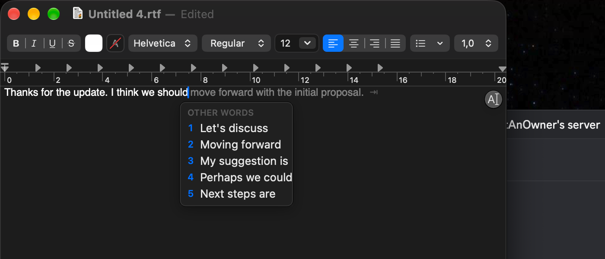
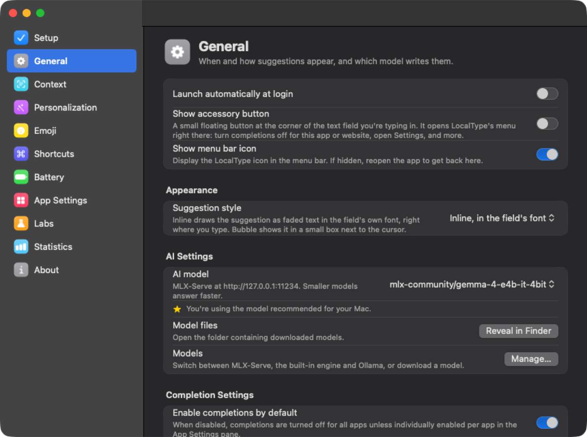

# LocalType

A macOS menu-bar app that suggests how to finish your sentence in **any app**, using a language model that runs **entirely on your Mac**. Independent, unofficial project inspired by tools like Cotypist; not affiliated with them.

<p align="center"></p>

- Ghost-text suggestion at the caret · each **Tab** accepts one word · **⌥Tab** accepts it all · **Esc** dismisses
- Models: MLX-Serve (default when installed; uses any chat model it has, nothing downloaded), a built-in [llama.cpp](https://github.com/ggml-org/llama.cpp) engine (Metal, download / import GGUF in-app), or Ollama
- Screen context: reads the window you're typing in (ScreenCaptureKit + on-device Vision OCR) so replies fit the conversation. Only the column of the field you're in counts (not a chat list or sidebar beside it), and after a click, another tab or chat, or a sent message it reads the window again before suggesting
- Emoji: `:fire` → 🔥, `:thumbs_up:`, a lone ` :` for your most-used, emoticons (`:-)` → 🙂, `<3` → ❤️), preferred skin tone and gender (↓/↑ for other matches)
- Inline ghost text in the field's own font (read via Accessibility), or a bubble; typo fixes strike through the typo
- Per-app and per-website rules (websites work in any browser), typing-history viewer with per-app deletion
- Statistics: today, a 7/30/90/365-day chart by day/week/month, daily average, estimated time saved
- Battery: suggestions only on demand, a smaller model, shorter completions; "current word only" length; Setup page that flags macOS inline predictions
- Works in Chromium/Electron apps (Chrome, Slack, Discord, VS Code…): enables their accessibility tree and finds the caret through text markers
- Background-aware look: a tiny screenshot next to the caret gives readable contrast and a solid backing over text after the cursor
- Labs: alternative words under the cursor and synonyms for a selected word (press 1–5); optional floating accessory button
- Typing history encrypted at rest; optional sync between your Macs through iCloud Drive, end-to-end encrypted with a passphrase
- About page with a GitHub release check; `localtype://settings/<page>`, `localtype://setup`, `localtype://history` links
- Per-app enable/disable, typo guard with suggested fixes, custom style instructions, optional clipboard context,
  optional local writing history for personalization, battery pausing, remappable shortcuts, local statistics
- No accounts, no analytics, nothing sent anywhere

<p align="center"></p>

## Download

Get `LocalType-<version>.zip` from [Releases](https://github.com/ramirobuisan/localtype/releases), unzip it and move LocalType.app to Applications. The app isn't notarized, so the first time macOS blocks it: open System Settings → Privacy & Security and click "Open Anyway". The setup window then walks you through permissions and the model.

## Build

Requires macOS 14+, Apple Silicon, Swift 5.9+ (Command Line Tools are enough).

```bash
./scripts/fetch-llama.sh   # downloads the prebuilt llama.cpp framework into Vendor/
./build.sh                 # builds and signs LocalType.app (ad-hoc; use SIGN_ID="My Cert" ./build.sh to sign with your own certificate)
open LocalType.app
```

On first launch a setup window walks through **Accessibility** permission (required), the model, and the optional extras (screen context needs **Screen Recording**). With MLX-Serve running, LocalType picks a loaded chat model automatically; pick a small one for speed. Measured on an M5 Max: `mlx-community/gemma-4-e4b-it-4bit` (5.2 GB) answers in ~30–130 ms (recommended: best phrasing, uses your name from the style instructions), `mlx-community/Qwen3.5-4B-MLX-4bit` (3.1 GB) is as fast but rougher, a dense 31B model takes ~1–1.5 s. Add one with `mlx-serve pull <id>` and `curl -X POST http://127.0.0.1:11234/v1/models/rescan`. Without it, open *Models…* and download a GGUF (e.g. Qwen2.5 3B).

Releasing: `scripts/release.sh <version> <notes.md>` bumps the version, builds an ad-hoc-signed app, checks it contains nothing from your Mac, and publishes the zip with its SHA-256 (the app's built-in updater verifies downloads against it). `scripts/make-icon.swift` regenerates the app icon.

Self-tests: `--selftest model.gguf "text"` (built-in engine), `--selftest-mlx "text"` (MLX-Serve), `--selftest-emoji ":fir"`, `--selftest-screen <pid>`, `--selftest-screen-layout` (which screen text a reply box gets, on a mock chat window), `--selftest-field <bundle ID>` (reads an app's focused field, with its screen text), `--selftest-labs`, `--selftest-update`, and `LOCALTYPE_SUPPORT_DIR=/tmp/x --selftest-sync` (two simulated Macs in a scratch folder).

Headless engine check: `LocalType.app/Contents/MacOS/LocalType --selftest model.gguf "Some text to continue"`

## How it works

An event tap watches keystrokes; after a short pause the Accessibility API reads the text before the caret, the model continues it, and a click-through panel shows the result at the caret. Tab is swallowed only while a suggestion is visible. Accepted text is typed back with synthetic key events. Instruct models are asked to continue the text at a ‸ cursor marker (raw continuation makes them degenerate): through the chat endpoint with MLX-Serve and Ollama, and through the model's own chat template in the built-in engine (models without one get the text to continue). The prompt carries the app and website, and for a half-typed word the dictionary's likely words. The reply is re-joined to the text (spacing, mid-word, echoes) and checked for made-up figures, a switch of language, placeholders, run-on sentences, repeats and replies addressed to the user.

## Limits

Apps that don't expose caret bounds via Accessibility (some Electron apps, terminals) get no suggestions. The first screen-context read in a session takes ~25 s while the OCR model loads (it's warmed up in the background at launch); after that ~0.15–0.3 s. Ad-hoc builds lose the Accessibility grant on every rebuild; sign with your own certificate (`SIGN_ID=…`) to keep it.

## License

MIT. llama.cpp is MIT-licensed; downloaded models carry their own licenses.
